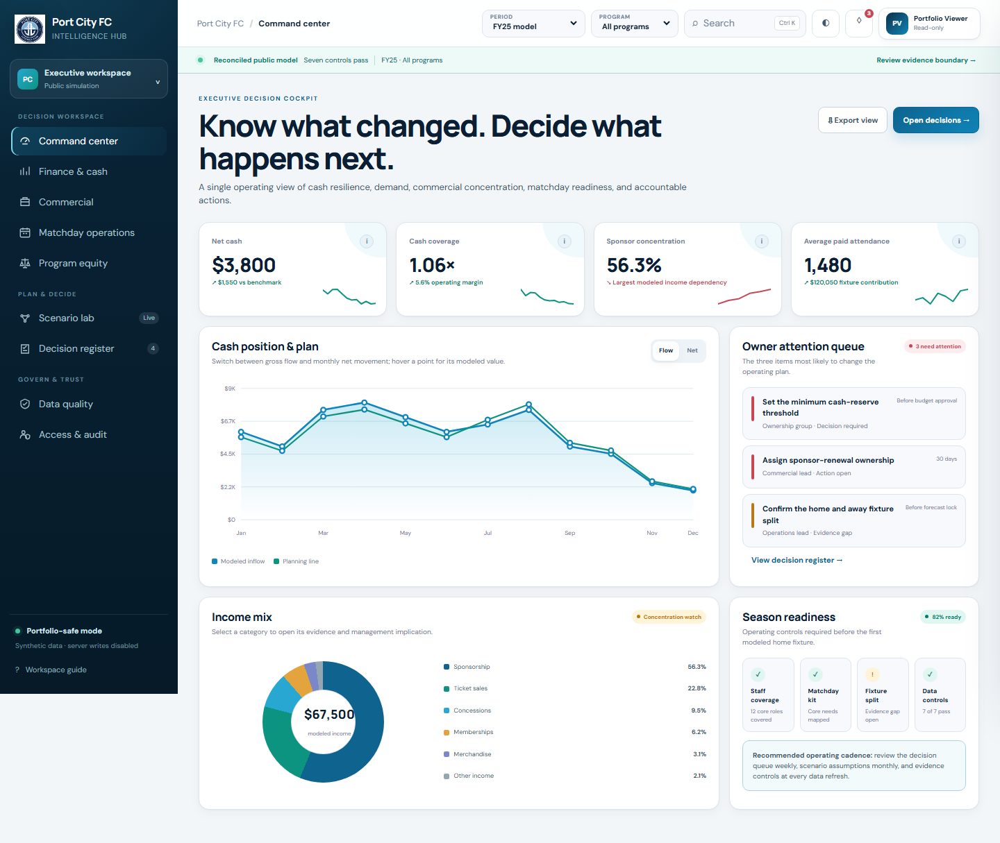
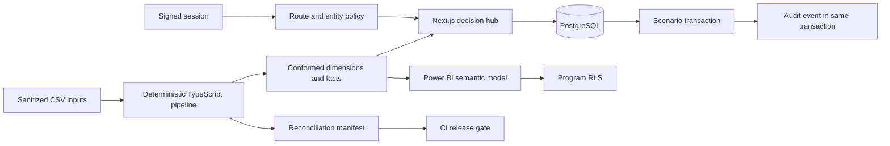

# Port City FC Decision Intelligence Hub

A sanitized, recruiter-facing business-analysis portfolio project that turns a mixed evidence pack into an executive decision product, a governed PostgreSQL workflow, and a reproducible Power BI model.

> **Evidence boundary:** every public figure is synthetic or deliberately generalized. This repository contains no staff identities or contact channels, bank or transaction rows, payees, private filenames, document hashes, or attributed messages. It is an independent portfolio case study, not an audited financial statement and not an official Port City FC system.

## Portfolio deliverables

- **Live read-only demo:** [port-city-fc-intelligence-hub.deniropro.chatgpt.site](https://port-city-fc-intelligence-hub.deniropro.chatgpt.site)
- **Three-minute walkthrough:** [`walkthrough/port-city-fc-intelligence-hub-walkthrough.webm`](walkthrough/port-city-fc-intelligence-hub-walkthrough.webm)
- **Analytical workbook:** [`outputs/01a128c4-1c8c-71b0-819c-29eaae5a311f/PortCityFC_Analytics_Companion.xlsx`](outputs/01a128c4-1c8c-71b0-819c-29eaae5a311f/PortCityFC_Analytics_Companion.xlsx)
- **Power BI project:** [`powerbi/PortCityFCCompanion/PortCityFCCompanion.pbip`](powerbi/PortCityFCCompanion/PortCityFCCompanion.pbip)

The hosted demo is a purpose-built, interactive executive workspace with nine decision views. It publishes no runtime database, credentials, mutation endpoint, or private evidence. The full repository retains the locally verified PostgreSQL scenario-and-audit vertical slice.

## What this proves

- **Executive communication:** a decision cockpit connects cash, commercial concentration, matchday readiness, program equity, accountable actions, and explicit evidence limits.
- **Business analysis:** charter, requirements, process maps, RACI, RAID, KPI definitions, UAT, and traceability stay connected to current product behavior.
- **Data engineering:** raw public inputs build deterministic dimensions/facts, SHA-256 manifests, and seven zero-difference reconciliation checks.
- **Application engineering:** Next.js, TypeScript, PostgreSQL, migrations, organization scoping, secure sessions, route policies, entity permissions, and transactional audit writes.
- **BI engineering:** a source-controlled Power BI Project (`.pbip`) with Power Query, DAX, a star-schema constellation, and program-level RLS roles.
- **Delivery discipline:** privacy scanning, cross-platform formatting, automated interaction tests, database-backed E2E verification, CI, and a read-only public deployment mode.

## Product tour



| Workspace           | Decision purpose                                              | Interactive behavior                                             |
| ------------------- | ------------------------------------------------------------- | ---------------------------------------------------------------- |
| Command center      | What changed and what needs owner attention now?              | KPI trends, flow/net toggle, category drill-down, decision queue |
| Finance & cash      | Where are liquidity and spend concentration under pressure?   | Period filter, monthly rhythm, evidence drawer, CSV export       |
| Commercial          | Where are sponsor, delivery, and acquisition risks?           | Sponsor search/drill-down, funnel and channel analysis           |
| Matchday operations | Are modeled home fixtures operationally and economically fit? | Program filter, fixture cards, unit-economics drill-down         |
| Program equity      | How do equivalent Men’s and Women’s program drivers compare?  | Like-for-like KPIs and fixture evidence                          |
| Scenario lab        | What changes under attendance, pricing, and cost assumptions? | Live sliders, presets, waterfall, break-even and export          |
| Decision register   | Who owns each finding, recommendation, and due date?          | Priority/status filters and executive detail drawers             |
| Data quality        | Why should a reviewer trust the public model?                 | Reconciliation controls, lineage, freshness and privacy rules    |
| Access & audit      | Who can do what and what changed?                             | Permission contract and synthetic audit evidence                 |

Global conveniences include cross-workspace filters, `Ctrl+K` navigation, responsive mobile navigation, light/dark themes, tooltips, print-ready meeting briefs, local CSV exports, alerts, and a persistent evidence-boundary explanation.

## Architecture



The public deployment is a static privacy-safe adapter generated from the same sanitized source model. It performs local filtering, scenario calculation, drill-down, export, and theme persistence without a server or database. The full Next.js application uses `PUBLIC_DEMO_MODE=true` for read-only pages and scenario feeds; local and CI verification exercise its PostgreSQL workflow separately.

## Quick start

Requirements: Node.js 24+, npm, and optionally Docker for the database-backed workflow.

```bash
npm ci
npm run data:build
npm run dev
```

Open `http://127.0.0.1:3000/ownership`. Development mode defaults to a read-only demonstration if no database is configured.

To preview the exact recruiter-facing static deployment on loopback:

```bash
npm run site:preview
```

Open `http://127.0.0.1:4173`. `npm run site:check` validates the generated bundle and privacy patterns; `npm run site:test` exercises navigation, scenario recalculation, search, drill-down, theming, and mobile overflow in Chromium.

For the complete persisted scenario workflow:

```bash
docker compose up -d postgres
cp .env.example .env.local
# Replace SESSION_SECRET and DEMO_ADMIN_PASSWORD in .env.local.
npm run db:migrate
npm run db:seed
npm run dev
```

Sign in with the local demonstration account shown on the login page and the password you set in `DEMO_ADMIN_PASSWORD`.

## Source-to-model pipeline

`npm run data:build` reads the small, reviewable files in `data/raw/`, validates privacy and control totals, and regenerates `data/processed/`.

Release gates currently prove:

- monthly inflow = category inflow = **$67,500**;
- monthly outflow = category outflow = **$63,700**;
- net cash = **$3,800**;
- all 12 months and both modeled programs are present;
- all seven checks pass with a difference of zero; and
- output hashes are recorded in `data/processed/reconciliation.json`.

Run `npm run data:check` after the repository has been initialized; it rebuilds the model and fails if generated outputs drift.

## PostgreSQL and audit workflow

The Scenario Lab is the complete vertical slice:

1. the client loads organization-scoped scenarios from `/api/scenarios`;
2. route and server permission checks require `scenarios:read` or `scenarios:write`;
3. Zod validates the command;
4. PostgreSQL creates or versions the scenario; and
5. the corresponding audit event commits in the same transaction.

Deletes are also organization-scoped and audited. The UI reloads from the server after each command and presents the recent scenario audit trail. Public mode returns read-only presets and rejects writes.

## Authorization model

- Page routes use explicit policies (`lib/auth/policies.ts`) rather than a blanket “signed in” check.
- API handlers repeat authorization on the server; UI visibility is never the control boundary.
- Generic entity endpoints resolve entity-specific read and write permissions.
- Database queries include `organization_id` in their predicate.
- Signed JWT claims are validated for issuer, audience, expiry, and known role; persisted sessions can be revoked.
- Same-origin checks protect state-changing requests.

The complete matrix is in [`docs/operations/permission-matrix.md`](docs/operations/permission-matrix.md).

## Power BI companion

Open [`powerbi/PortCityFCCompanion/PortCityFCCompanion.pbip`](powerbi/PortCityFCCompanion/PortCityFCCompanion.pbip) in Power BI Desktop, replace the `DataRoot` parameter with the absolute path to `data/processed`, and refresh.

The semantic model includes:

- `DimDate`, `DimProgram`, `DimMetric`, and `DimCategory`;
- finance, category, and operations fact tables at documented grains;
- one-direction, one-to-many relationships;
- DAX measures for inflow, outflow, net cash, margin, category amount, attendance, and ticket price; and
- `MenProgramViewer` and `WomenProgramViewer` RLS roles on `DimProgram`.

`npm run powerbi:build` regenerates the PBIP source; `npm run powerbi:check` fails on drift. See [`powerbi/README.md`](powerbi/README.md) for the Power Query, DAX, RLS, and Desktop validation checklist.

The analytical workbook in `outputs/01a128c4-1c8c-71b0-819c-29eaae5a311f/` provides an Excel-friendly Ownership Snapshot, reconciliations, model map, and data dictionary from the same processed data.

## Verification

```bash
npm run privacy:scan
npm run data:check
npm run powerbi:check
npm run site:check
npm run format:check
npm run lint
npm run typecheck
npm run test
npm run build
npm run site:test
E2E_DATABASE_URL=postgres://... npx playwright test --project=desktop
```

CI runs this sequence against PostgreSQL 17 and retains Playwright evidence on failure. The current execution record is in [`docs/ba/uat-results.md`](docs/ba/uat-results.md), with requirement links in [`docs/ba/traceability-matrix.md`](docs/ba/traceability-matrix.md).

## Repository map

```text
app/                 Next.js pages and protected API routes
components/          Decision UI, filters, charts, and server-backed scenario state
data/raw/            Sanitized source inputs under review limits
data/processed/      Generated dimensions, facts, hashes, and reconciliation
docs/                BA artifacts, controls, UAT, traceability, and operations
lib/auth/            Session, RBAC, route policies, and server guards
powerbi/             PBIP, Power Query, DAX, TMDL model, PBIR report, and RLS
prisma/migrations/   PostgreSQL schema and permission evolution
scripts/             Pipeline, PBIP generator, migrations, seed, backup, privacy scan
site/                Source for the nine-workspace recruiter-facing static deployment
tests/               Unit, integration, and Playwright E2E coverage
walkthrough/         Narration, reproducible recorder, application frames, and final video
```

## Known limits

- Public figures demonstrate the analysis method; they must not be treated as club actuals.
- The public site is deliberately read-only and has no database or production credentials.
- Power BI Desktop is required for the final native render, visual interaction check, and Service role assignment.
- Organizational adoption would require approved source contracts, KPI sign-off, real-role UAT, accessibility testing with target users, and an executed recovery drill.

See [`docs/ba/production-readiness-assessment.md`](docs/ba/production-readiness-assessment.md) for the full decision boundary.
