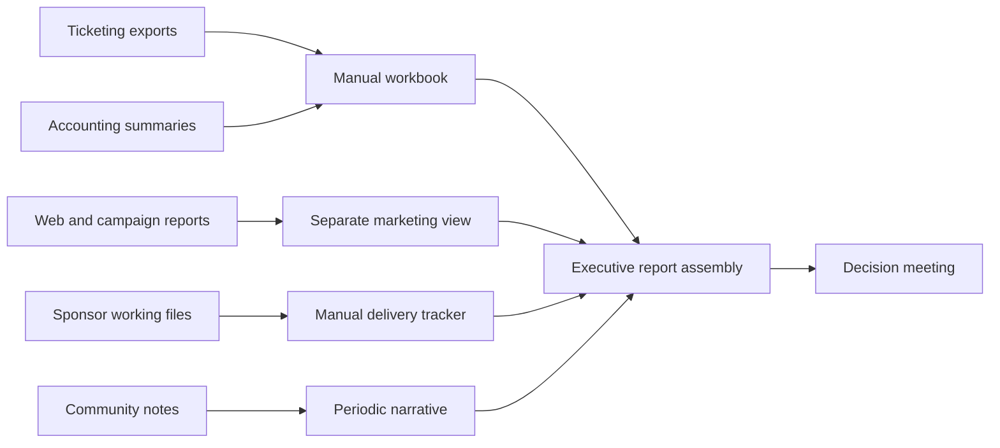

# Current-State Process

## Documented assumptions

Because this is an independent case study with no internal discovery, the process below is a hypothesis to validate—not a claim about Port City FC operations.

## Likely pain points

1. Definitions and reporting periods differ by source.
2. External IDs and duplicates are resolved late.
3. Formula logic is buried in working files.
4. Sponsor evidence and financial performance are not connected.
5. Program comparisons can obscure shared costs or use unequal measures.
6. Community figures may lack source classification.
7. Access and change history depend on file-sharing practices.

## Baseline risks

Delayed decisions, inconsistent metrics, accidental overwrite of historic periods, spreadsheet formula injection, unauthorized access, and external use of unverified demonstration-style figures.
