# Entity-Relationship Diagram

```mermaid
erDiagram
  ORGANIZATION ||--o{ USER : provisions
  USER ||--o{ SESSION : authenticates
  ORGANIZATION ||--o{ SEASON : owns
  ORGANIZATION ||--o{ TEAM : owns
  ORGANIZATION ||--o{ COMPETITION : configures
  ORGANIZATION ||--o{ VENUE : configures
  SEASON ||--o{ FIXTURE : contains
  TEAM ||--o{ FIXTURE : plays
  COMPETITION ||--o{ FIXTURE : classifies
  VENUE ||--o{ FIXTURE : hosts
  FIXTURE ||--o{ ATTENDANCE_RECORD : records
  FIXTURE ||--o{ REVENUE_ITEM : earns
  FIXTURE ||--o{ COST_ITEM : incurs
  ORGANIZATION ||--o{ TICKET_CATEGORY : configures
  ORGANIZATION ||--o{ TICKET_CHANNEL : configures
  SPONSOR_PACKAGE ||--o{ SPONSOR : groups
  SPONSOR ||--o{ SPONSOR_CONTACT : has
  SPONSOR ||--o{ SPONSOR_DELIVERABLE : owes
  CAMPAIGN ||--o{ FUNNEL_METRIC : measures
  FIXTURE ||--o{ FUNNEL_METRIC : attributes
  ORGANIZATION ||--o{ SUPPORTER_COHORT : groups
  COMMUNITY_PROGRAM ||--o{ COMMUNITY_IMPACT_RECORD : evidences
  ORGANIZATION ||--o{ SCENARIO : owns
  USER ||--o{ SCENARIO : creates
  ORGANIZATION ||--o{ KPI_TARGET : governs
  ORGANIZATION ||--o{ RISK : tracks
  ORGANIZATION ||--o{ RECOMMENDATION : owns
  ORGANIZATION ||--o{ IMPORT_BATCH : receives
  USER ||--o{ IMPORT_BATCH : commits
  ORGANIZATION ||--o{ AUDIT_EVENT : records
  USER ||--o{ AUDIT_EVENT : acts
  ORGANIZATION ||--o{ APPLICATION_SETTING : configures
```

## Design notes

Organization is the authorization and data-isolation boundary. Foreign keys prevent orphaned operational data; uniqueness constraints protect stable identifiers; nonnegative and date-order checks reject invalid states. Scenario assumptions use JSON because the input set evolves, while financially material actual records remain typed relational rows. The generic operational register supports admin staging, but the production model’s reporting facts are the named relational tables.
