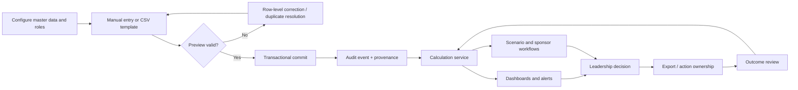

# Future-State Process

## Control points

- Administrators configure identity, categories, targets, and assumptions.
- Stable external IDs and uniqueness constraints prevent duplicates.
- Rows are parsed as data, size-limited, schema-validated, and previewed.
- Authorized writes commit atomically and append an audit event.
- Calculated metrics display methodology and source classification.
- Role checks occur in both the interface and the server handler.
- Historical seasons remain addressable; configuration changes apply prospectively.
- Reports include generation time, active filters, provenance, and calculation version.

## Exception paths

Invalid rows remain outside the transaction. Provider totals that fail reconciliation are quarantined for owner review. Failed imports do not partially alter live records. Restore is performed into an isolated database and verified before controlled cutover.
